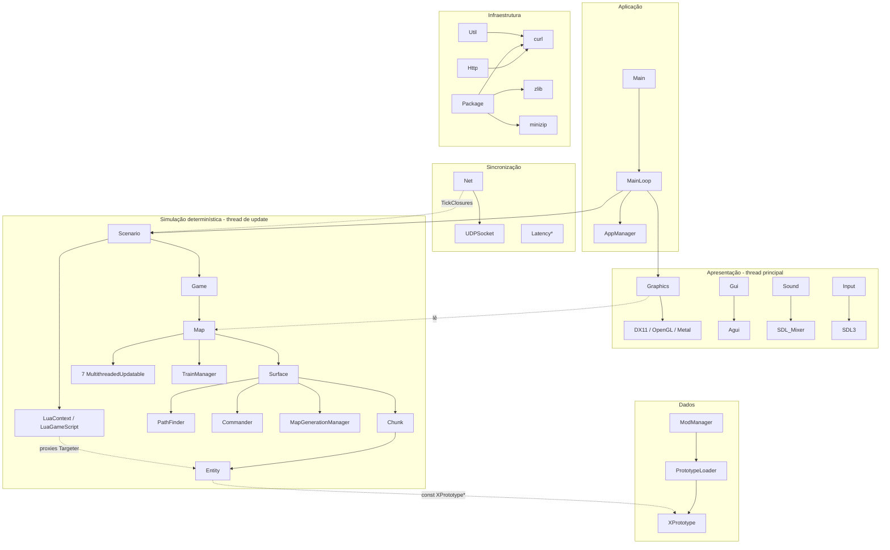
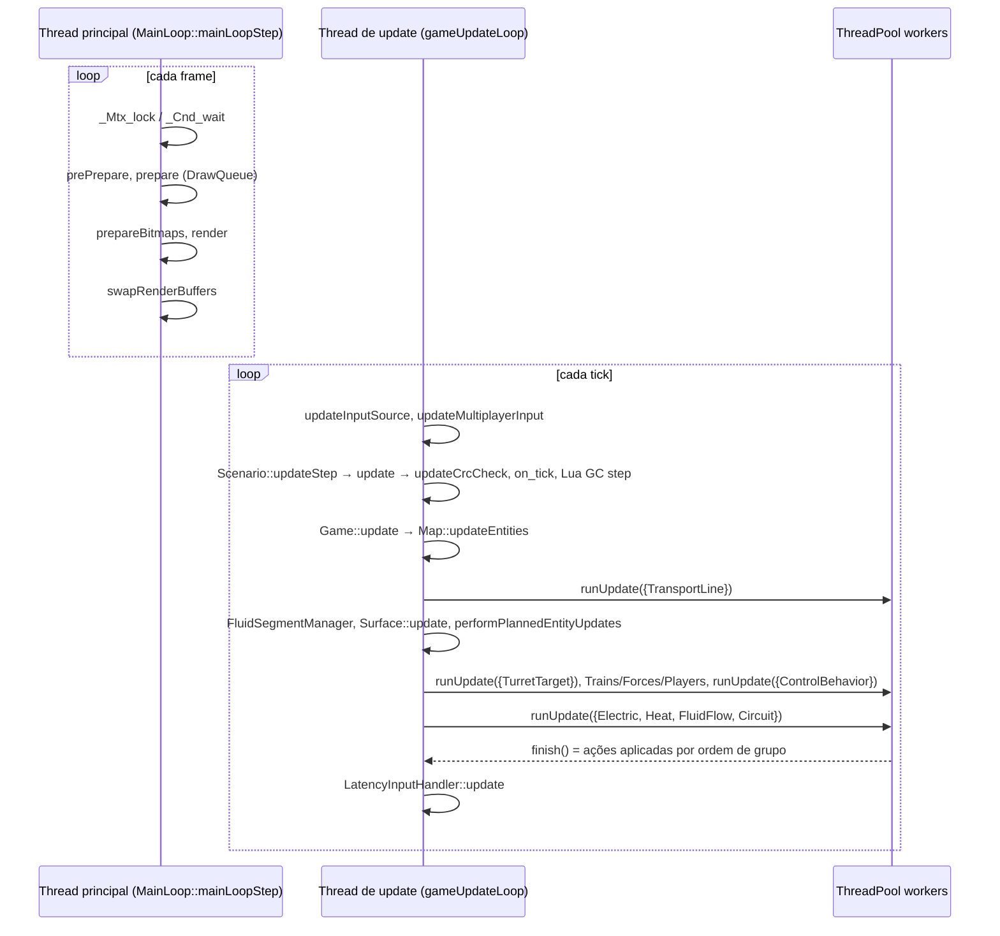
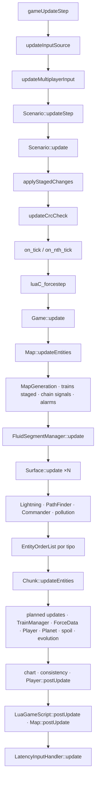
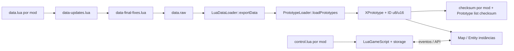
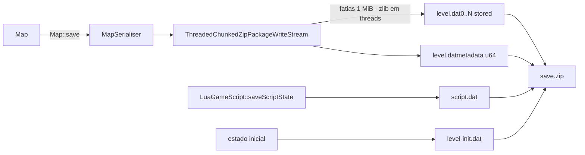
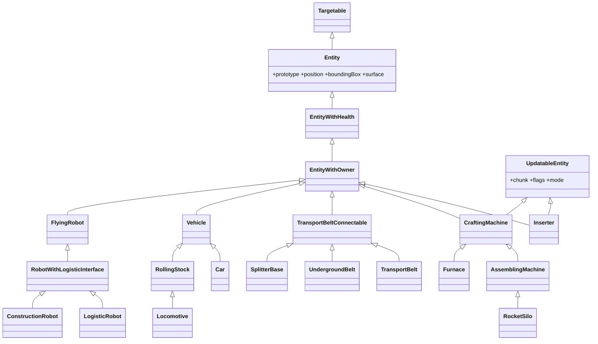

# ARCHITECTURE_DIAGRAMS — Diagramas

Diagramas em Mermaid (renderizam no GitHub, VS Code e Obsidian). Cada nó vem de um nome do PDB [C]; as setas indicam chamadas diretas observadas [C] ou relações inferidas (assinaladas com `..>`/tracejado) [I].

## 1. Camadas e dependências entre módulos


## 2. Threads e sincronização


## 3. Tick (fluxograma)


## 4. Pipeline de dados (mods → protótipos → jogo)


## 5. Multiplayer
```mermaid
sequenceDiagram
  participant C as Cliente
  participant S as Servidor
  C->>S: ConnectionRequest
  S->>C: ConnectionRequestReply / AcceptOrDeny
  S->>C: MapReadyForDownload
  C->>S: TransferBlockRequest
  S->>C: TransferBlock ×N
  C->>C: carregar mapa, TryingToCatchUp
  S->>C: ClientShouldStartSendingTickClosures
  loop cada tick
    C->>S: ClientToServerHeartbeat (InputActions p/ tick futuro)
    S->>C: ServerToClientHeartbeat (TickClosures ordenadas)
    C->>C: aplicar TickClosure no tick T; CheckCRC
  end
  Note over C,S: CRC divergente → PlayerDesynced → novo download + relatório
```

## 6. Save


## 7. Hierarquia de entidades (resumo; completa em `artifacts/entity_hierarchy.txt`)

