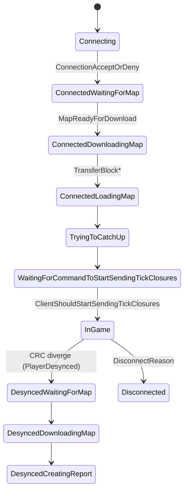

# NETWORKING_ANALYSIS — Multiplayer e networking

Fonte principal: `src/Net/` (76 classes, 133 ficheiros) e enums/layouts do PDB [C]. Não foi capturado tráfego real [N].

## 1. Modelo: lockstep determinístico com servidor autoritativo de *inputs* [I, forte]

| Evidência [C] | Conclusão |
|---|---|
| `InputAction { MapTick updateTick; InputActionType type; uint16 playerIndex; char buffer[112]; }` (128 B) | a unidade transmitida é uma **ação do jogador**, não estado |
| `TickClosure { MapTick updateTick; vector<InputAction>; vector<InputActionSegment>; }` | todas as ações de **um tick** agrupadas |
| `Heartbeat { u32 sequenceNumber; vector<TickClosure> tickClosures; flags HAS_HEARTBEAT_REQUESTS, HAS_TICK_CLOSURES, HAS_SINGLE_TICK_CLOSURE, ALL_TICK_CLOSURES_ARE_EMPTY, HAS_SYNCHRONIZER_ACTIONS }` | pacote periódico com os ticks fechados e as ações de controlo |
| `ServerSynchronizer::mergeNextTickClosure`, `processTickClosuresToJump`, `tweakClientLatencies`, `getDefaultRoundtripLatency` | o **servidor ordena** as ações e decide em que tick se aplicam |
| `ClientSynchronizer::latencyWindowBegin/End`, `getRoundTripLatency` | o cliente envia ações para um tick futuro (janela de latência) |
| `Scenario::updateCrcCheck`, `getCrc`, `HeuristicCrcGenerator::get/saveMap`, `MapSerialiser::savingForHeuristicCrc`, `InputActionType::CheckCRC (97)`, `CheckCRCHeuristic (85)`, `ForceFullCRC (51)`, `MainLoop::checkHeavyModeCrc` | **deteção de desync por CRC** do estado, trocado como ação |
| `ParallelDesyncReportCreator`, estados `DesyncedWaitingForMap … DesyncedCreatingReport`, URL `https://factorio.com/multiplayer-desync` | em desync, o cliente volta a descarregar o mapa e gera um relatório |

Todos os peers correm a mesma simulação a partir do mesmo save, aplicando as mesmas `InputAction` nos mesmos ticks. Daí as exigências de determinismo de todo o motor: ponto fixo, RNG próprio, Lua determinístico.

## 2. Transporte [C]
- **UDP** (`UDPSocket`, `UDPSocketInterface`), porta por omissão **34197** (`pingpong{1..4}.factorio.com:34197`). Também há `TCPSocket`, usado pelo RCON [I].
- Fiabilidade própria: `TransmissionControlHelper`, `MaxPacketSize`, `PayloadWriteStream`, `InputActionSegmenter`/`InputActionDesegmenter` (ações grandes, como blueprints, partidas em segmentos), `NetworkMessageType::reliable()` [C].
- Transferência do mapa: `TransferBlockRequest`/`TransferBlock`, `TransferSource`/`TransferTarget`, `TransferRateHelper` [C].
- NAT: `GetOwnAddress`, `NatPunchRequest`, `NatPunch`, `PingPongServers` [C].
- Descoberta LAN: `LANBroadcast`, `LANServerGameListener` [C]; pública: `MatchingServer`, `ServerGameUpdater`, `ServerGameFilters` [C].
- Autenticação: `AuthServerConnector` → `https://auth.factorio.com` [C]; `ServerKeyWithTimestamp` [C].

### Tipos de mensagem (`NetworkMessageType::Enum`) [C]
`0 Ping · 1 PingReply · 2 ConnectionRequest · 3 ConnectionRequestReply · 4 ConnectionRequestReplyConfirm · 5 ConnectionAcceptOrDeny · 6 ClientToServerHeartbeat · 7 ServerToClientHeartbeat · 8 GetOwnAddress · 9 GetOwnAddressReply · 10 NatPunchRequest · 11 NatPunch · 12 TransferBlockRequest · 13 TransferBlock · 14 RequestForHeartbeatWhenDisconnecting · 15 LANBroadcast · 16 GameInformationRequest · 17 GameInformationRequestReply · 18 Empty`

### Ações de sincronização (`SynchronizerActionType::Enum`) [C]
`GameEnd, PeerDisconnect, NewPeerInfo, ClientChangedState, ClientShouldStartSendingTickClosures, MapReadyForDownload, MapLoadingProgressUpdate, MapSavingProgressUpdate, SavingForUpdate, MapDownloadingProgressUpdate, CatchingUpProgressUpdate, PeerDroppingProgressUpdate, PlayerDesynced, BeginPause, EndPause, SkippedTickClosure, SkippedTickClosureConfirm, ChangeLatency, IncreasedLatencyConfirm, SavingCountDown`

## 3. Máquinas de estado [C]
**Cliente** (`ClientMultiplayerStateType`): `Ready → Connecting → ConnectedWaitingForMap → ConnectedDownloadingMap → ConnectedLoadingMap → TryingToCatchUp → WaitingForCommandToStartSendingTickClosures → InGame`, com ramos `Desynced*`, `InGameSavingMap`, `Disconnect*`, `Failed`.
**Servidor** (`ServerMultiplayerStateType`): `Ready, PreparedToHostGame, CreatingGame, InGame, InGameSavingMap, InGameSavingMapForDesyncReport, Disconnecting*, Closed, Failed`.
**Motivos de desconexão** (`DisconnectReason`): `Quit, Dropped, Reconnect, WrongInput, Desynced, CantKeepUp, AFK, Kicked, KickedAndDeleted, Banned, BannedByAuthServer, SwitchingServers`.

## 4. Ocultação de latência no cliente [C nomes, I comportamento]
`LatencyState`, `LatencyStateAdapter`, `LatencySurface`, `LatencyChunk`, `LatencyCursorAdapter`, `LatencyDrivingState`, `LatencyOneTimeEffect`, `LatencyUndoRedoStack`, `LatencyInputHandler`, `ControllerLatencyState`; `Entity::setMarkedForDeconstructionInLatencyState`, `setMinedInLatencyState`… Enquanto uma ação está "em voo", o cliente **mostra** o efeito previsto (ex.: entidade minada, ghost colocado) numa camada de estado sobreposta, que não toca no estado determinístico. A camada é descartada quando o tick real chega.

## 5. Deteção de desync [C nomes, I mecanismo]
1. O estado de jogo é **serializado** com `MapSerialiser` em modo `savingForHeuristicCrc` → `HeuristicCrcGenerator::saveMap` → CRC32 (`crc32fast` [C]).
2. O CRC é trocado como `InputAction` `CheckCRC`/`CheckCRCHeuristic` (para todos os peers aplicarem a verificação no mesmo tick).
3. Se divergir → `SynchronizerActionType::PlayerDesynced` → o cliente entra em `Desynced*` e o `ParallelDesyncReportCreator` gera o relatório (`MainLoop::saveHeuristicWithTags`, `Scenario::dumpHeuristic`, `prepareDesyncReport`).
- "Heavy mode" (`MainLoop::checkHeavyModeCrc`) [C]: modo de diagnóstico com CRC completo a cada tick [I].

## 6. Permissões e administração [C]
`PermissionsCommandProcessor`, `LuaPermissionGroup(s)`, `InputActionType::EditPermissionGroup`, `PlayerAdminChange`, `ServerCommand`; `RemoteCommandProcessor`, `LuaRCON` (RCON). Cada `InputAction` pode ser verificada contra o grupo de permissões do jogador (`AllowedCommands` [C]) [I].

## 7. Lacunas
- Formato binário exato dos pacotes (cabeçalho, flags, fragmentação) [N]: exige descompilação de `NetworkMessage::save` / `Heartbeat::saveBase` ou captura de tráfego.
- Polinómio/variante do CRC de desync: crc32fast implica CRC-32 IEEE [I]; não verificado.
- Cifra/integridade dos pacotes: nenhuma evidência de cifra no transporte UDP [N, sem conclusão].
